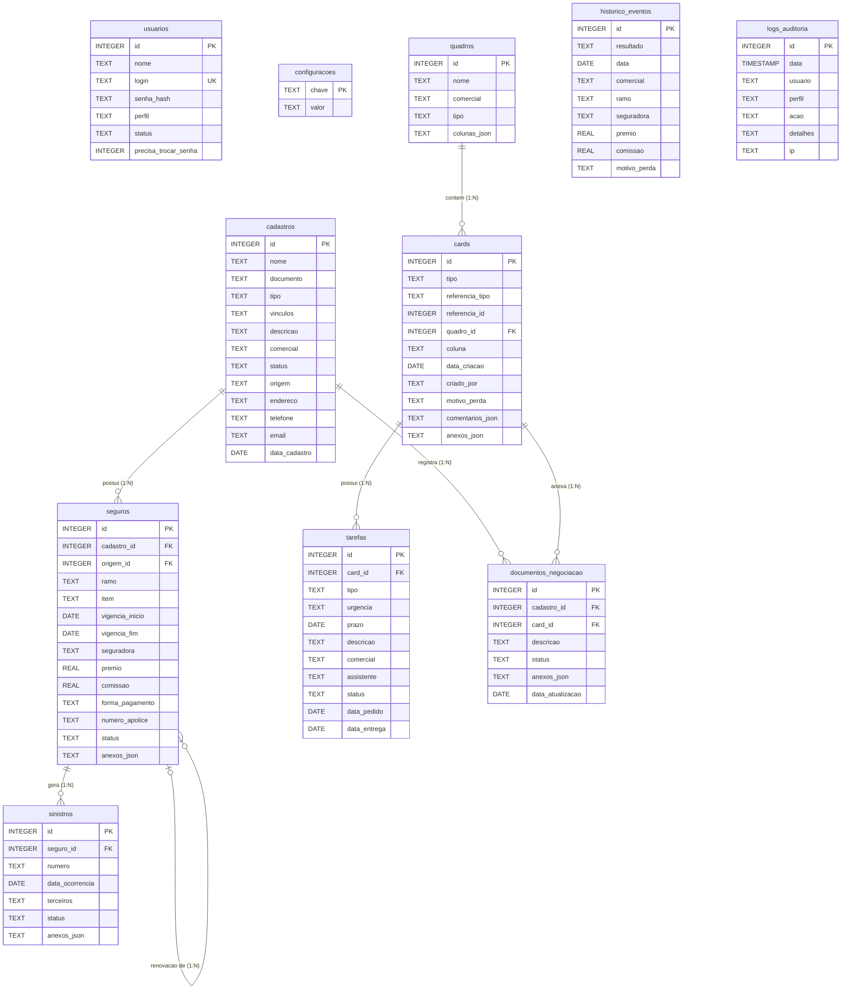

# Diagrama Entidade-Relacionamento (MER / DER)

Este documento descreve a modelagem de dados relacional do sistema da corretora de seguros implementada sobre o banco de dados SQLite (`corretora.db`).

---

## 📊 Diagrama de Entidades e Relacionamentos

---

## 🔑 Descrição das Tabelas e Integridade

| Tabela | Função no Sistema | Regras de Integridade |
|---|---|---|
| **`usuarios`** | Colaboradores da corretora e seus perfis de acesso. | `login` único; senhas com hash criptográfico; `precisa_trocar_senha` força redefinição no primeiro uso. |
| **`configuracoes`** | Parâmetros globais personalizáveis (ex: Nome da Corretora, CNPJ). | Chave primária textual única; busca centralizada para todo o sistema. |
| **`cadastros`** | Segurados (Pessoa Física ou Pessoa Jurídica) e seus dados de contato. | Vínculo obrigatório com o comercial responsável da carteira. |
| **`quadros`** | Pipelines Kanban de **Seguros** e de **Sinistros** vinculados a cada comercial. | Criados automaticamente no cadastro de cada comercial; deletados em cascata ao remover o comercial. |
| **`seguros`** | Apólices contratadas ou propostas em negociação. | `cadastro_id` (FK ON DELETE CASCADE); `origem_id` aponta para a apólice anterior em caso de renovação. |
| **`sinistros`** | Ocorrências de sinistro registradas sob uma apólice coberta. | `seguro_id` (FK ON DELETE CASCADE); acompanhamento de terceiros e regulação. |
| **`cards`** | Cartões operacionais do Kanban (Renovação, Novo, Endosso, Sinistro). | `quadro_id` (FK ON DELETE CASCADE); guarda coluna atual, histórico de comentários e anexos. |
| **`tarefas`** | Atividades delegadas entre Comercial e Assistente (cotação, vistoria, etc.). | `card_id` (FK ON DELETE CASCADE); prazos, status e urgência. |
| **`documentos_negociacao`**| Registro documental e histórico de anexos da negociação. | Relaciona cliente (`cadastro_id`) e negociação (`card_id`). |
| **`historico_eventos`** | Memória estática de eventos (fechados, renovados, perdidos e comissões). | Usado na geração de métricas de retenção e gráficos financeiros. |
| **`logs_auditoria`** | Trilha de auditoria e segurança. | Registra data, hora, IP, usuário e ação executada para conformidade e segurança. |
