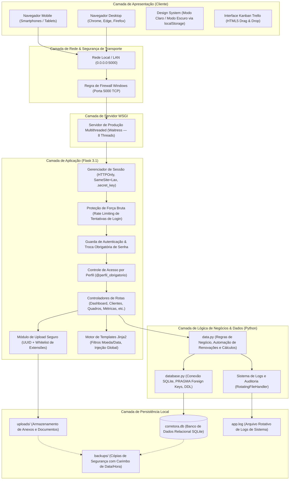

# Diagrama de Arquitetura do Sistema

Este documento descreve a arquitetura em camadas do Sistema de Gestão de Corretora de Seguros, cobrindo da interface do usuário até a persistência de dados e segurança.

---

## 🏛️ Visão Geral da Arquitetura

---

## 🛡️ Camadas e Responsabilidades

1. **Cliente:**
   * Aplicação web responsiva compatível com dispositivos móveis e desktops.
   * Renderização imediata anti-flicker de tema claro/escuro.
   * Interações ricas no Kanban (arrastar e soltar cartões sem recarregar tela).

2. **Servidor e Rede:**
   * **Waitress WSGI:** processa múltiplas conexões em paralelo com 8 threads simultâneas, ideal para trabalho em equipe na rede da corretora.
   * Firewall configurado automaticamente na primeira inicialização para permitir tráfego local na porta 5000.

3. **Aplicação (Flask):**
   * Verificação de primeiro acesso forçando redefinição da senha padrão.
   * Cookies assinados com proteção contra sequestro via JavaScript (`HTTPOnly`).
   * Sanitização rigorosa de uploads impedindo a execução de códigos maliciosos.

4. **Persistência:**
   * **`corretora.db`:** Banco de dados ACID relacional local, com chaves estrangeiras ativas (`PRAGMA foreign_keys = ON`).
   * Script de backup automatizado (`fazer_backup.bat`) para preservação histórica.
