# Diagrama de Casos de Uso (Perfis e Permissões)

Este documento descreve os atores do sistema, seus respectivos perfis e as ações que cada um tem permissão de executar.

---

## 👥 Diagrama de Casos de Uso por Perfil

```mermaid
flowchart LR
    subgraph ATORES["Atores do Sistema"]
        ADM["Administrador"]
        COM["Comercial"]
        AST["Assistente"]
        SIN["Área Sinistros"]
    end

    subgraph CASOS_COMUNS["Casos de Uso Gerais"]
        UC_LOGIN["Efetuar Login / Logout"]
        UC_SENHA["Definir Senha Inicial Obrigatória"]
        UC_DASHBOARD["Visualizar Dashboard e Alertas"]
        UC_BUSCA["Pesquisar Clientes e Apólices"]
    end

    subgraph CASOS_ADM["Exclusivo do Administrador"]
        UC_CONFIG["Configurar Dados e Nome da Corretora"]
        UC_USUARIOS["Gerenciar Usuários (Cria/Exclui Comerciais)"]
        UC_AUDIT["Consultar Logs de Auditoria do Sistema"]
    end

    subgraph CASOS_COM["Atuação do Comercial"]
        UC_CLIENTES["Cadastrar e Atualizar Clientes da Carteira"]
        UC_KANBAN_COM["Operar Quadro de Seguros Próprio"]
        UC_PEDIR_TAREFA["Delegar Tarefas (Cálculo, Cotação)"]
        UC_FINALIZAR["Fechar ou Marcar Card como Perdido"]
    end

    subgraph CASOS_AST["Atuação do Assistente"]
        UC_VER_SEGUROS["Acessar Quadros de Seguros de Todos os Comerciais"]
        UC_ENTREGAR_TAREFA["Realizar e Entregar Tarefas Pendentes"]
        UC_ANEXAR_DOCS["Anexar Cálculos e Propostas ao Card"]
    end

    subgraph CASOS_SIN["Atuação da Área de Sinistros"]
        UC_KANBAN_SIN["Operar Quadros de Sinistros de Todos os Comerciais"]
        UC_REGULAR["Acompanhar Regulação e Vistoria"]
        UC_LIQUIDAR["Concluir Sinistro com Indenização"]
    end

    subgraph CASOS_GESTAO["Gestão e Análise"]
        UC_METRICAS["Consultar Métricas de Retenção e Conversão"]
        UC_RELATORIOS["Filtrar e Exportar Relatório Geral (CSV)"]
    end

    %% Acesso Comum
    ADM --> UC_LOGIN
    COM --> UC_LOGIN
    AST --> UC_LOGIN
    SIN --> UC_LOGIN

    ADM --> UC_SENHA
    ADM --> UC_DASHBOARD
    COM --> UC_DASHBOARD
    AST --> UC_DASHBOARD
    SIN --> UC_DASHBOARD

    ADM --> UC_BUSCA
    COM --> UC_BUSCA
    AST --> UC_BUSCA
    SIN --> UC_BUSCA

    %% Acesso Administrador
    ADM --> UC_CONFIG
    ADM --> UC_USUARIOS
    ADM --> UC_AUDIT
    ADM --> UC_METRICAS
    ADM --> UC_RELATORIOS

    %% Acesso Comercial
    COM --> UC_CLIENTES
    COM --> UC_KANBAN_COM
    COM --> UC_PEDIR_TAREFA
    COM --> UC_FINALIZAR
    COM --> UC_METRICAS

    %% Acesso Assistente
    AST --> UC_VER_SEGUROS
    AST --> UC_ENTREGAR_TAREFA
    AST --> UC_ANEXAR_DOCS

    %% Acesso Sinistros
    SIN --> UC_KANBAN_SIN
    SIN --> UC_REGULAR
    SIN --> UC_LIQUIDAR
```

---

## 📋 Matriz de Permissões por Papel (RBAC)

| Funcionalidade / Tela | Administrador | Comercial | Assistente | Área Sinistros |
|---|:---:|:---:|:---:|:---:|
| **Configurações da Corretora** | ✅ Total | ❌ Sem acesso | ❌ Sem acesso | ❌ Sem acesso |
| **Gerenciamento de Usuários** | ✅ Total | ❌ Sem acesso | ❌ Sem acesso | ❌ Sem acesso |
| **Logs de Auditoria** | ✅ Total | ❌ Sem acesso | ❌ Sem acesso | ❌ Sem acesso |
| **Dashboard Executivo** | ✅ Completo | ✅ Próprio | ✅ Operacional | ✅ Operacional |
| **Carteira de Clientes** | ✅ Todos | ✅ Vinculados | ✅ Todos | ✅ Apenas com sinistro |
| **Quadros de Seguros (Kanban)**| ✅ Todos | ✅ Apenas o seu | ✅ Todos | ❌ Sem acesso |
| **Quadros de Sinistros (Kanban)**| ✅ Todos | ✅ Apenas o seu | ❌ Sem acesso | ✅ Todos |
| **Pedir Nova Tarefa** | ✅ Sim | ✅ Sim | ❌ Não | ❌ Não |
| **Entregar Tarefa** | ✅ Sim | ❌ Não | ✅ Sim | ✅ Sim |
| **Exportação de Relatórios** | ✅ Sim | ✅ Sim | ✅ Sim | ✅ Sim |
| **Métricas e Gráficos** | ✅ Sim | ✅ Sim | ✅ Sim | ✅ Sim |
