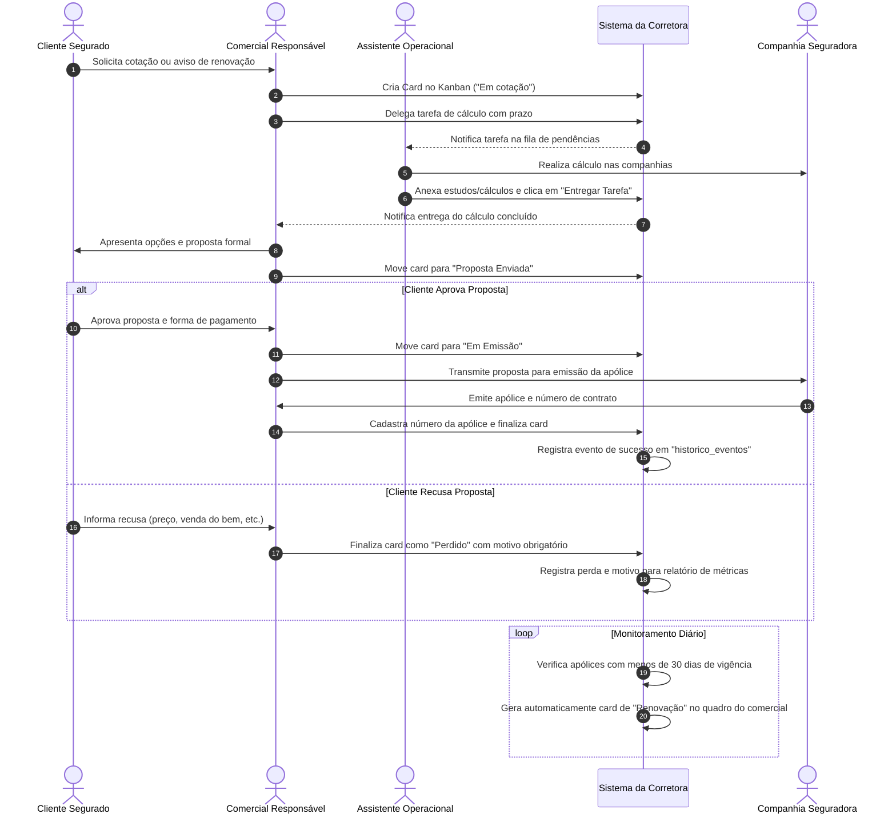
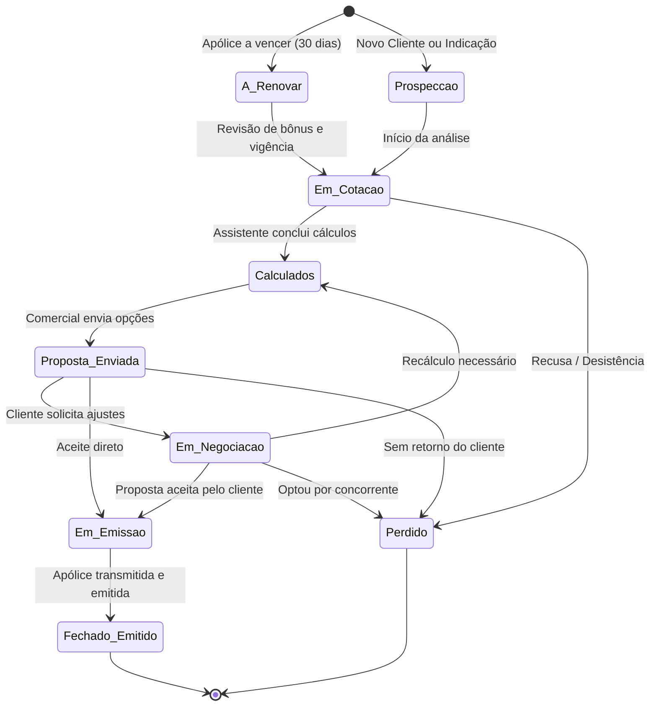
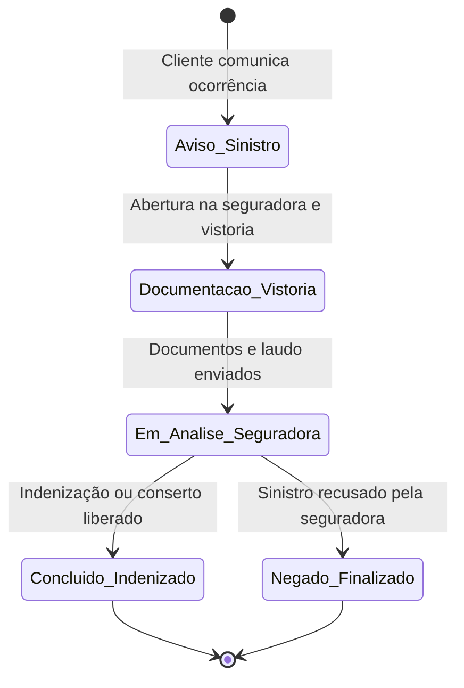

# Fluxo Comercial e Ciclo de Vida do Kanban

Este documento detalha o fluxo de trabalho entre os colaboradores da corretora e os estados pelos quais um card de negociação ou sinistro transita no Kanban.

---

## 🌊 1. Fluxo Comercial em Raias (Swimlane)

---

## 🔄 2. Máquina de Estados: Card de Seguros

---

## 🛡️ 3. Máquina de Estados: Card de Sinistro

